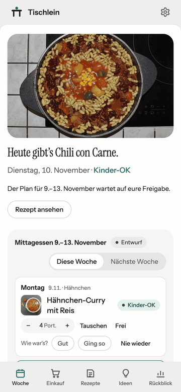
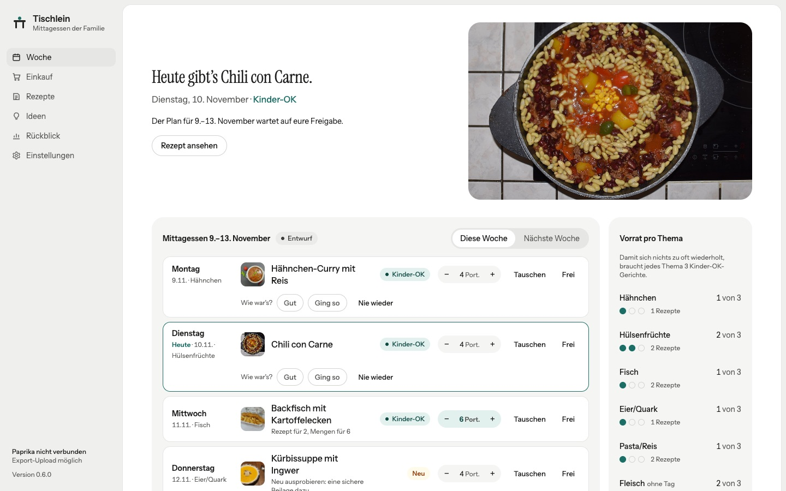

# Tischlein

[](https://github.com/schowave/tischlein/actions/workflows/ci.yaml)
[](https://github.com/schowave/tischlein/releases)
[](https://github.com/schowave/tischlein/pkgs/container/tischlein)

**Der Mittagsplan für die Familie.** Tischlein plant jede Woche eiweißreiche Gerichte aus euren
[Paprika](https://www.paprikaapp.com)-Rezepten, achtet darauf, was die Kinder essen, und bringt den
freigegebenen Plan als Kalender aufs iPhone, die Einkaufsliste in die Hosentasche und den
Vorbereitungs-Hinweis am Vorabend über Home Assistant.

Das Prinzip ist „Sous-Chef“: Tischlein schlägt vor, die Familie gibt frei.

<p align="center">
  
</p>



<sub>Bilder mit Demo-Daten (`scripts/demo.py`) und gemeinfreien Fotos, Nachweise unten.</sub>

## Inhalt

- [Was Tischlein kann](#was-tischlein-kann)
- [Schnellstart](#schnellstart)
- [Einrichtung](#einrichtung)
- [Auf dem iPhone](#auf-dem-iphone)
- [Konfiguration](#konfiguration)
- [Bedienung über die Kommandozeile](#bedienung-über-die-kommandozeile)
- [HTTP-API](#http-api)
- [Releases und automatisches Deployment](#releases-und-automatisches-deployment)
- [Betrieb auf dem Proxmox hinter Cloudflare](#betrieb-auf-dem-proxmox-hinter-cloudflare)
- [Daten und Sicherungen](#daten-und-sicherungen)
- [Entwicklung](#entwicklung)
- [Bekannte Grenzen](#bekannte-grenzen)
- [Bildnachweise](#bildnachweise)

## Was Tischlein kann

**Planen**
- **Thementage**, z. B. Mo Hähnchen, Di Hülsenfrüchte, Mi Fisch, Do Eier/Quark, Fr Pasta/Reis.
  Auf jeden Tag kommt ein Rezept mit der passenden Paprika-Kategorie.
- **Kinder-OK zuerst:** An normalen Tagen nur Gerichte, die die Kinder essen. „Vorrat pro Thema“
  zeigt, wo noch welche fehlen.
- **Rotation statt Wiederholung:** Ein Gericht kommt frühestens nach zwei Wochen wieder, gut
  bewertete öfter.
- **Neu-Slot:** einmal pro Woche ein Rezept mit der Kategorie „Neu“. Nach dem Essen entscheidet
  ihr: „Gut“ nimmt es in die Rotation, „Nie wieder“ wirft es raus.
- **Freigabe:** Tage tauschen, die Woche neu würfeln, freigeben. Nur freigegebene Wochen landen
  im Kalender. Feiertage (bundesweit und pro Bundesland), Urlaub oder Kita markieren Tage als frei.
- **Portionen pro Gericht:** Standard ist eure Familiengröße; mit − und + pro Tag änderbar.
  Rezepte werden umgerechnet („Rezept für 2, Mengen für 4“).
- **Was die Kinder nicht mögen** (z. B. „Pilze, Oliven“) steht in den Einstellungen; solche
  Gerichte plant Tischlein nur, wenn nichts anderes übrig ist.
- **Schnelle Tage:** „Schnell“ an einem vollen Tag wählt ein Gericht bis 30 Minuten.

**Kochen und einkaufen**
- **Heute auf einen Blick:** das Gericht mit Foto, Kochzeit und was ihr für morgen vorbereiten
  müsst (TK auftauen, Hülsenfrüchte einweichen …).
- **Kochen:** Zutaten auf eure Portionen umgerechnet und zum Abhaken, die Schritte groß lesbar;
  der Bildschirm bleibt an.
- **Einkaufsliste nach Zutaten:** gleiche Zutaten aus allen Rezepten zusammengeführt, Mengen
  addiert und auf die Portionen umgerechnet, sortiert nach Gang im Laden, darunter für welche
  Gerichte. Vorräte wie Salz und Öl bleiben weg. Mit LLM noch genauer, ohne LLM per Regeln.
- **Gemeinsam abhaken, auch ohne Netz:** Was die andere Person abhakt, erscheint nach wenigen
  Sekunden; im Laden ohne Empfang wird nachgeholt. Eigene Einträge dazuschreiben, alles abhaken,
  Abgehaktes entfernen, die Liste mit „An Bring“ (über Home Assistant) oder „Teilen“ weitergeben. Neue Einträge
  melden sich über Home Assistant auf dem Handy der anderen.
- **Bewertung nach jedem Essen:** gut, ging so, nie wieder. Lieblingsgerichte kommen öfter.

**Entdecken und zurückblicken**
- **Ideen:** neue Gerichte vom LLM, passend zu dem, was ihr mögt, mit Fortschrittsanzeige; per
  Klick als „Neu“ und „KI“ nach Paprika.
- **Rückblick:** was gekocht wurde, Themen, Bewertungen, Lieblinge, die lange nicht dran waren.
- **Reste verwerten:** Die Rezeptsuche findet auch Zutaten, „Zucchini Feta“ zeigt alles mit beidem.
- **Rezeptverwaltung** mit Foto, Zutaten und Kinder-OK-Schalter; Kategorien und Papierkorb werden
  sofort nach Paprika zurückgeschrieben.

**Verbinden**
- **Kalender-Abo** für iPhone und Mac über einen geheimen Link.
- **Home Assistant:** Sensor „Mittagessen heute“, Plan per Automation, Meldungen per Webhook
  (neuer Plan, Freigabe, Vorabend, Einkaufsliste).
- **Hell und dunkel:** folgt der Einstellung des Geräts.
- **Paprika** über die Cloud-Synchronisation, alternativ per Export-Datei.

## Schnellstart

Voraussetzungen: [mise](https://mise.jdx.dev), Docker mit Compose und ein Paprika-Konto mit
aktivierter Cloud-Synchronisation.

```bash
git clone https://github.com/schowave/tischlein.git
cd tischlein
mise trust && mise run docker:build
mkdir -p data && sudo chown 10001 data   # der Container läuft als UID 10001
docker compose up -d
```

Danach `http://<host>:8080` öffnen und unter **Einstellungen** das Paprika-Konto eintragen. Die
Daten liegen im Ordner `./data`.

Nur ansehen, ohne Paprika: `uv run --frozen python scripts/demo.py data-demo` und
`TISCHLEIN_DB=data-demo/tischlein.db uv run --frozen tischlein serve` (siehe [Entwicklung](#entwicklung)).

## Einrichtung

1. **Paprika verbinden:** unter **Einstellungen → Paprika-Konto** E-Mail und Passwort eintragen.
   Tischlein prüft die Anmeldung und gleicht danach die Rezepte im Hintergrund ab. Der erste
   Abgleich dauert einige Minuten.
2. **Kategorien prüfen:** Die Themen aus `tischlein.toml` müssen als Paprika-Kategorien existieren.
   In der Rezeptverwaltung lassen sie sich anlegen und zuordnen, dort setzt ihr auch Kinder-OK.
3. **Woche planen:** auf der Startseite „Woche planen“, einzelne Tage tauschen, dann „Woche
   freigeben“.
4. **Kalender aufs iPhone:** unter **Einstellungen → Kalender auf dem iPhone** den Knopf „Auf
   diesem Gerät abonnieren“ am iPhone öffnen. Das iPhone fragt, in welchem Konto der Kalender
   liegen soll, iCloud bringt ihn auf alle Geräte.
5. **Home Assistant** (optional):

   ```yaml
   # configuration.yaml
   rest:
     - resource: http://tischlein:8080/api/heute
       scan_interval: 1800
       sensor:
         - name: Mittagessen heute
           value_template: "{{ value_json.gericht }}"

   rest_command:
     tischlein_plan_erzeugen:
       url: http://tischlein:8080/api/plaene/naechste/erzeugen
       method: post
   ```

   Eine Automation, z. B. samstags um 10:00, ruft `rest_command.tischlein_plan_erzeugen` auf. Den
   Kalender bindet ihr über die Integration „Remote Calendar“ mit dem Abo-Link ein.

Ohne Paprika-Konto lassen sich Rezepte auch per Export einlesen: in Paprika unter Einstellungen →
Import/Export im Paprika-Format exportieren und die Datei auf der Startseite hochladen.

## Auf dem iPhone

- **Als App auf den Home-Bildschirm:** in Safari „Teilen → Zum Home-Bildschirm“. Tischlein bekommt
  ein eigenes Symbol und unten eine Leiste mit Woche, Einkauf, Rezepten, Ideen und Rückblick.
- **Updates:** Jede Seite kommt frisch vom Server, CSS und JavaScript tragen die Version im Link.
  Nach einem Release ist die neue Fassung beim nächsten Öffnen da; hängt die App noch im
  Speicher, einmal in der App-Übersicht schließen.
- **Benachrichtigungen:** über die Home-Assistant-App, siehe `HA_WEBHOOK_URL` und
  [`docs/betrieb.md`](docs/betrieb.md).
- Von außen nur über Cloudflare Access erreichbar (siehe unten); die Anmeldung läuft einmal im
  Browser.

## Konfiguration

### `tischlein.toml`

| Schlüssel | Standard | Bedeutung |
|---|---|---|
| `plan.kinder_tag` | `Kinder-OK` | Kategorie für Gerichte, die die Kinder essen |
| `plan.neu_tag` | `Neu` | Kategorie für Rezepte zum Ausprobieren |
| `plan.ki_tag` | `KI` | Kategorie für Rezepte, die aus einer übernommenen KI-Idee stammen |
| `plan.hauptspeise_tag` | `Hauptspeisen` | Nur solche Gerichte (oder mit Thema) kommen in den Neu-Slot |
| `plan.portionen` | `4` | So viele Portionen plant Tischlein pro Gericht; die Einkaufsliste rechnet die Rezepte darauf um, pro Tag änderbar |
| `plan.neu_slot` | `do` | Wochentag des Neu-Slots, `""` schaltet ihn ab |
| `plan.cooldown_wochen` | `2` | Mindestabstand, bevor ein Gericht wiederkommt |
| `plan.weitere_themen` | `["Fleisch"]` | Themen ohne eigenen Tag, für die Rezeptverwaltung |
| `plan.feiertage_land` | `""` | Bundesland für Landesfeiertage, z. B. `"BW"`; leer = nur bundesweite |
| `abgleich.alle_minuten` | `15` | Automatische Prüfung auf Änderungen in Paprika, `0` = aus |
| `einkauf.vorrat` | Salz, Pfeffer, Öl … | Was nie auf die Einkaufsliste kommt |
| `erinnerung.uhrzeit` | `"18:00"` | Vorabend-Meldung an Home Assistant, `""` = aus |
| `[[tage]]` | Mo–Fr | Ein Eintrag pro Thementag: `tag = "mo"`, `thema = "Hähnchen"` |

Kalendername, Uhrzeit und Dauer stellt ihr unter **Einstellungen** ein.

### Umgebungsvariablen

| Variable | Standard | Bedeutung |
|---|---|---|
| `TISCHLEIN_DB` | `data/tischlein.db` | Pfad zur SQLite-Datenbank |
| `TISCHLEIN_CONFIG` | `tischlein.toml` | Pfad zur Konfiguration |
| `PAPRIKA_EMAIL`, `PAPRIKA_PASSWORD` | – | Alternative zu den Einstellungen; ein dort eingetragenes Konto hat Vorrang |
| `PAPRIKA_USER_AGENT` | `Tischlein/0.1` | Kennung gegenüber Paprika |
| `HA_WEBHOOK_URL` | – | Meldungen an Home Assistant: neuer Plan, Vorabend, Einträge auf der Einkaufsliste |

Für Docker gehören sie in eine `.env`-Datei, Vorlage: [`.env.example`](.env.example). Die `.env`
wird nie eingecheckt.

## Bedienung über die Kommandozeile

Alle Befehle laufen in der von mise verwalteten Umgebung (`mise exec --` davor oder mise in der
Shell aktivieren):

```bash
uv run tischlein sync                                   # Rezepte mit Paprika abgleichen
uv run tischlein plan --woche naechste [--freigeben]    # Plan erzeugen
uv run tischlein import Rezepte.paprikarecipes          # Export einlesen
uv run tischlein tags-anwenden vorschlaege.csv          # Kategorien aus CSV, ohne --ausfuehren nur Probelauf
uv run tischlein serve [--port 8080]                    # Web-Oberfläche und API
```

## HTTP-API

| Methode | Pfad | Zweck |
|---|---|---|
| `GET` | `/api/heute`, `/api/morgen` | Gericht, Vorbereitung, freier Tag, für Home Assistant |
| `GET` | `/api/einkauf?woche=…` | Einkaufsliste der Woche |
| `POST` | `/api/einkauf/{woche}/eintrag` | `{"name": "Kaffee", "menge": "500 g"}`, meldet sich bei Home Assistant |
| `POST` | `/api/einkauf/{woche}/alle-erledigt`, `…/erledigte-entfernen` | Alles abhaken, Abgehakte entfernen |
| `POST` | `/api/einkauf/{woche}/bring` | Offene Einträge an Home Assistant, von dort auf die Bring-Liste |
| `POST` | `/api/bring/listen` | Home Assistant meldet seine Bring-Listen (für die Auswahl in den Einstellungen) |
| `POST` | `/api/ideen/start`, `GET /api/ideen/status` | Rezeptideen im Hintergrund erzeugen, Fortschritt |
| `GET` | `/api/plan?woche=aktuell\|naechste\|JJJJ-MM-TT` | Wochenplan als JSON |
| `POST` | `/api/plaene/{woche}/erzeugen` | Paprika abgleichen und einen Entwurf erzeugen |
| `POST` | `/api/sync` | Nur abgleichen |
| `GET` | `/api/rezepte`, `/api/rezepte/{uid}` | Rezepte, Zutaten und Kategorien |
| `POST` | `/api/rezepte/{uid}/tags` | `{"hinzufuegen": [...], "entfernen": [...]}`, schreibt nach Paprika |
| `POST` | `/api/rezepte/{uid}/papierkorb`, `…/wiederherstellen` | Papierkorb in Paprika |
| `GET` | `/kalender/{token}.ics` | Kalender-Abo mit geheimem Schlüssel |
| `GET` | `/healthz` | Health-Check |

## Releases und automatisches Deployment

```
GitHub-Release vX.Y.Z ──▶ Action „Release“ ──▶ ghcr.io/schowave/tischlein:X.Y.Z, X.Y, latest
                                                        │
LXC auf dem Proxmox: tischlein-update.timer (alle 5 Min) ◀┘ holt latest, startet neu,
                     prüft /healthz, bei Fehler zurück auf die vorherige Version
```

1. **Release erstellen:** auf GitHub ein Release mit Tag `vX.Y.Z` veröffentlichen. Die Action prüft
   wie das CI, baut das Image über `mise run docker:publish` und testet das veröffentlichte Image.
2. **Ausrollen passiert von selbst:** Der Timer im LXC zieht `latest`. Er startet den Container nur
   neu, wenn sich das Image geändert hat, und wartet, bis `/healthz` die neue Version meldet.
   Sonst setzt er die vorherige Version wieder in Betrieb. Mit `HA_WEBHOOK_URL` meldet er
   erfolgreiche Updates an Home Assistant.
3. **Welche Version läuft:** unten in der Seitenleiste oder `curl http://<lxc>:8080/healthz`.

Der LXC braucht keinen offenen Port nach außen und GitHub keinen Zugang ins Heimnetz.

**Einmalige Einrichtung des LXC** (Debian mit Docker, z. B. über die community-scripts):

```bash
# im LXC als root
git clone https://github.com/schowave/tischlein.git /tmp/tischlein   # oder deploy/lxc/ kopieren
bash /tmp/tischlein/deploy/lxc/install.sh
```

Solange das Paket auf ghcr.io privat ist, braucht der LXC einmalig ein `docker login ghcr.io` mit
einem Token, das nur `read:packages` darf.

## Betrieb auf dem Proxmox hinter Cloudflare

- Container im LXC unter `/opt/tischlein` (siehe oben), Port 8080, Daten in `/opt/tischlein/data`.
- Tischlein hat keine eigene Anmeldung. Von außen nur über **Cloudflare Tunnel mit Cloudflare
  Access** erreichbar machen.
- Für den Pfad `/kalender/*` eine **Access-Bypass-Regel** anlegen. Der iPhone-Kalender kann sich
  nicht anmelden, der Link ist durch seinen geheimen Schlüssel geschützt. Wird er bekannt, erzeugt
  ihr unter Einstellungen einen neuen.
- Tischlein wertet `X-Forwarded-Proto` und `Host` aus, damit Abo-Links hinter dem Tunnel die
  öffentliche https-Adresse tragen.

## Daten und Sicherungen

Alles liegt in `./data`. Sichert den Ordner mit, z. B. über Proxmox Backup:

| Datei | Inhalt |
|---|---|
| `tischlein.db` | Pläne, Rückmeldungen, Einstellungen (inklusive Paprika-Zugang im Klartext), Rezept-Cache |
| `bilder/` | Lokal zwischengespeicherte Rezeptfotos |
| `paprika-backup-*.jsonl` | Fassungen der Rezepte vor jeder Änderung durch Tischlein |

Weil der Paprika-Zugang in der Datenbank steht, sollte `./data` nur für euch lesbar sein.

## Entwicklung

Einzige Voraussetzung ist [mise](https://mise.jdx.dev). Es installiert Python, uv und ruff in den
Versionen aus `mise.toml`, abgesichert über die Prüfsummen in `mise.lock`. Die Python-Abhängigkeiten
kommen strikt aus `uv.lock`. CI und Docker-Build nutzen dieselben Tasks, ein grünes
`mise run check` lokal ist also ein grünes CI.

```bash
mise trust && mise run setup   # Werkzeuge, Abhängigkeiten, Pre-commit-Hook
mise run check                 # ruff und Tests, wie im CI
mise run serve                 # lokal auf :8080, liest .env falls vorhanden, lädt bei Änderungen neu
mise run docker:build          # Image bauen
mise tasks                     # alle Tasks
```

**Demo-Daten** für Screenshots und das GIF oben, ganz ohne Paprika und LLM:

```bash
uv run --frozen python scripts/demo.py data-demo --fotos <ordner-mit-jpg>
TISCHLEIN_DB=data-demo/tischlein.db uv run --frozen tischlein serve --port 8091
```

Versionen aktualisieren: Version in `mise.toml` anheben, dann `mise lock --platform
linux-x64,linux-arm64,macos-arm64` für die Werkzeuge und `mise exec -- uv lock --upgrade` für die
Python-Abhängigkeiten.

Domänensprache, Planungsregeln und Aufbau: [`CLAUDE.md`](CLAUDE.md). Paprika-Schnittstelle:
[`docs/paprika-api.md`](docs/paprika-api.md), Betrieb: [`docs/betrieb.md`](docs/betrieb.md), offene
Punkte: [`docs/offen.md`](docs/offen.md), Review-Regeln: [`CODING_STANDARDS.md`](CODING_STANDARDS.md).
Neue Planungsregeln kommen immer zuerst als Test in `tests/test_planner.py`.

## Bekannte Grenzen

- Paprika hat **keine offizielle Schnittstelle**. Tischlein nutzt die inoffizielle Sync-API der
  Apps, sie kann sich jederzeit ändern. Tischlein ist nicht mit Paprika verbunden oder von Paprika
  unterstützt.
- Die Paprika-Server sperren IPs bei zu vielen Anfragen. Tischlein lädt deshalb nur geänderte
  Rezepte und macht Pausen zwischen den Abrufen.
- Freigegebene Pläne werden noch nicht in den Meal Planner von Paprika geschrieben.

## Bildnachweise

Die Fotos im GIF und im Screenshot zeigen Demo-Rezepte, nicht die Gerichte einer echten Familie.
Alle stehen unter [CC0](https://creativecommons.org/publicdomain/zero/1.0/) und kommen von Wikimedia
Commons bzw. dem WordPress Photo Directory:
[Chicken curry Trivandrum](https://commons.wikimedia.org/wiki/File:Chicken_curry_Trivandrum.jpg) (Abhilashsnair),
[Red lentil dal](https://wordpress.org/photos/photo/3046841291/) (Suraj Sutar),
[Fish and Chips Bath](https://commons.wikimedia.org/wiki/File:Fish_and_Chips_Bath,_UK.jpg) (Gvjekoslav),
[Kaiserschmarrn, Munich](https://commons.wikimedia.org/wiki/File:Kaiserschmarrn,_Munich.jpg) (Gerda Arendt),
[Spaghetti Bolognese](https://commons.wikimedia.org/wiki/File:Spaghetti_Bolognese_-_Figaros,_Brighton_2023-10-06.jpg) (Andy Li),
[Pumpkin soup](https://commons.wikimedia.org/wiki/File:Pumpkin_soup_in_dish_with_spoon.jpg) (o.tacke),
[Risotto de gambas](https://commons.wikimedia.org/wiki/File:Risotto_de_gambas,_restaurant_Danieli_(Vienne,_Autriche).jpg) (Benoît Prieur),
[Chili con carne](https://commons.wikimedia.org/wiki/File:Chili_con_carne_50_A.jpg) (René Hourdry).
